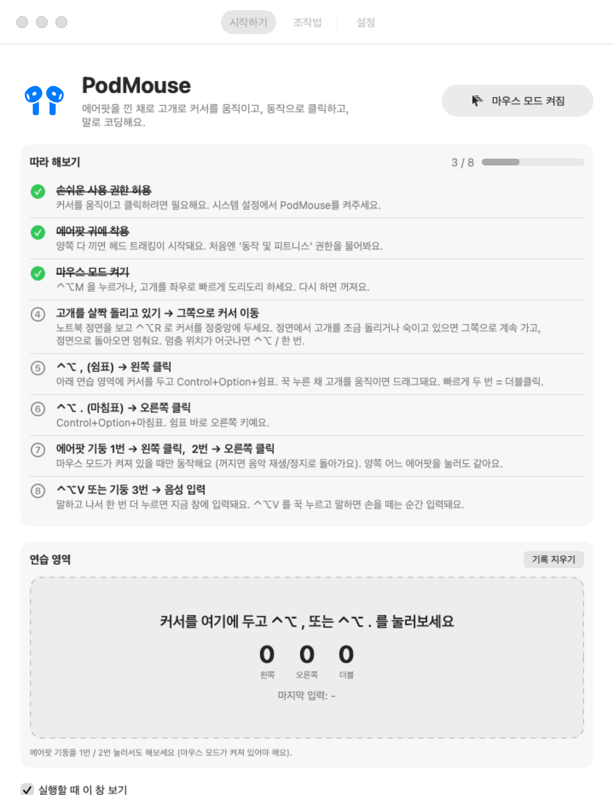
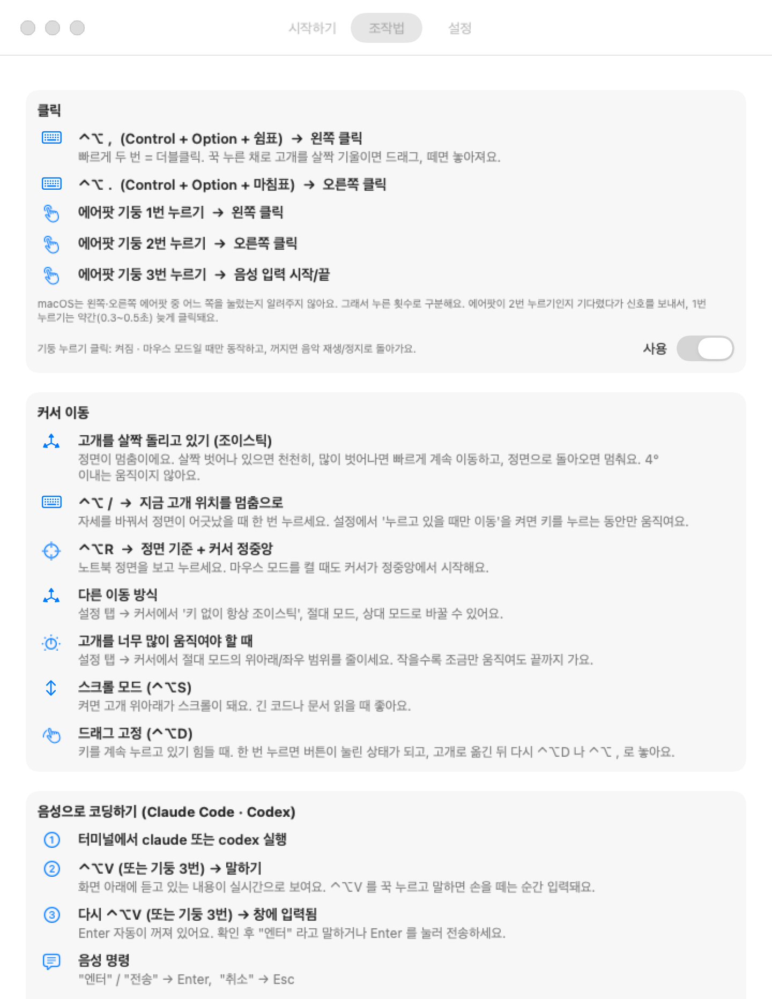
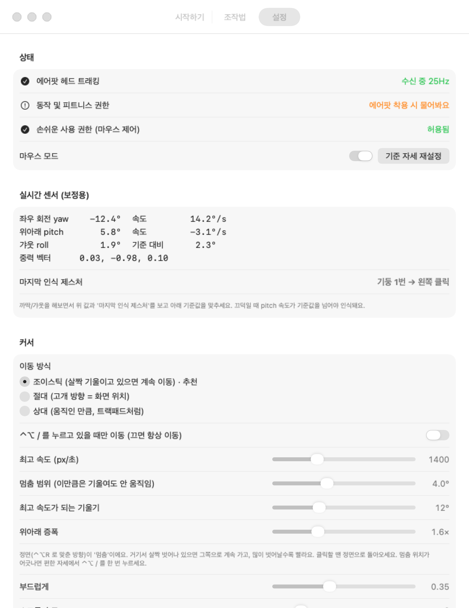

# PodMouse — 에어팟 머리 마우스

AirPods 4(및 헤드 트래킹 지원 AirPods Pro / 3세대 / Max)의 모션 센서로 커서를 움직이고,
머리 동작·기둥 누르기·단축키로 클릭하고, 음성으로 Claude Code·Codex에 말로 코딩하는 메뉴바 앱.

<p align="center">
  
</p>

## 이런 앱이에요

- 🎧 **에어팟이 마우스가 됩니다** — 별도 장비 없이, 귀에 낀 에어팟의 헤드 트래킹 센서로 고개를 살짝 기울여 커서를 움직여요.
- 🖱️ **손을 거의 안 쓰고 클릭** — 에어팟 기둥 1번/2번 누르기로 왼쪽/오른쪽 클릭, ⌃⌥ 단축키로 클릭·드래그·스크롤.
- 🗣️ **말로 코딩** — 기둥 3번(또는 ⌃⌥V)으로 음성 입력. 받아쓴 문장을 Claude Code·Codex가 돌고 있는 터미널에 바로 보내요.
- 🧭 **처음 써도 쉽게** — 단계별 체크리스트가 직접 해보면 자동으로 체크되고, 연습 영역에서 클릭을 시험해볼 수 있어요.
- ⚙️ **세밀한 보정** — 실시간 센서 값을 보면서 감도·데드존·제스처 기준을 맞출 수 있어요.

## 스크린샷

| 시작하기 | 조작법 | 설정 |
|---|---|---|
|  |  |  |
| 단계별 체크리스트 + 클릭 연습 영역 | 모든 동작과 단축키 설명 | 상태·실시간 센서·커서 감도 조절 |

## 요구 사항

- macOS 14 (Sonoma) 이상
- 헤드 트래킹을 지원하는 AirPods (AirPods 4 / AirPods 3세대 / AirPods Pro / AirPods Max)
- Xcode 또는 Command Line Tools (`swiftc`) — Xcode 프로젝트 없이 `build.sh` 하나로 빌드돼요

## 설치 (터미널)

터미널에 아래를 붙여넣으면 받아서 빌드하고 `/Applications`에 설치한 뒤 바로 실행해요.

```bash
git clone https://github.com/tony1010-dev/PodMouse.git ~/PodMouse
cd ~/PodMouse
./install.sh
```

`install.sh`가 하는 일
- macOS 버전과 Swift 컴파일러(Command Line Tools)가 있는지 확인
- 빌드 → `/Applications/PodMouse.app` 설치 → 실행
- 설치된 기본 SDK가 컴파일러 버전과 안 맞으면(`this SDK is not supported by the compiler`) 다른 SDK로 자동 재시도

> Command Line Tools가 없다고 나오면 `xcode-select --install` 로 먼저 설치하세요.

### 업데이트

```bash
cd ~/PodMouse && git pull && ./install.sh
```

### 삭제

```bash
~/PodMouse/install.sh uninstall
rm -rf ~/PodMouse
```

시스템 설정 → 개인정보 보호 및 보안 → 손쉬운 사용 목록에 남은 PodMouse 항목도 지워주세요.

### 직접 빌드

```bash
./build.sh            # build/PodMouse.app 생성
./build.sh install    # /Applications 에 설치하고 실행
SDKROOT=/Library/Developer/CommandLineTools/SDKs/MacOSX26.sdk ./build.sh   # SDK 지정
```

개발자 인증서(Apple Development / Developer ID)가 있으면 자동으로 그걸로 서명해요. 없으면 ad-hoc 서명이라,
다시 빌드할 때마다 손쉬운 사용 권한을 다시 켜야 할 수 있어요. 특정 인증서는 `PODMOUSE_SIGN_IDENTITY`로 지정할 수 있어요.

## 처음 실행

실행하면 **PodMouse 창**이 떠요.
- **시작하기**: 단계별 체크리스트 (직접 해보면 자동으로 체크됨)와 클릭 연습 영역
- **조작법**: 모든 동작과 단축키 설명
- **설정**: 감도, 제스처 인식 기준, 동작 연결, 실시간 센서 값

창을 닫아도 앱은 메뉴바에서 계속 돌아가요. 메뉴바 아이콘 → '사용 안내 열기'로 다시 열 수 있고,
Finder나 Spotlight에서 PodMouse를 다시 실행해도 창이 열려요.

처음 실행 시 허용할 권한
1. **손쉬운 사용** — 커서 이동·클릭·키 입력 (시스템 설정 → 개인정보 보호 및 보안 → 손쉬운 사용)
2. **동작 및 피트니스** — 에어팟을 귀에 끼면 물어봄
3. **마이크 / 음성 인식** — 처음 음성 입력할 때 물어봄

## 조작법

| 입력 | 동작 |
|---|---|
| 고개 좌우로 돌리기 / 위아래 | 커서 이동 |
| ⌃⌥ , (Control+Option+쉼표) | 왼쪽 클릭 · 두 번 = 더블클릭 · 꾹 누르고 고개 움직이기 = 드래그 |
| ⌃⌥ . (Control+Option+마침표) | 오른쪽 클릭 |
| 에어팟 기둥 1번 누르기 | 왼쪽 클릭 |
| 에어팟 기둥 2번 누르기 | 오른쪽 클릭 |
| 에어팟 기둥 3번 누르기 | 음성 입력 시작/끝 |

- 기둥 누르기는 **마우스 모드가 켜져 있을 때만** 클릭으로 바뀌어요. 꺼지면 음악 재생/정지로 돌아가요.
- macOS는 왼쪽·오른쪽 에어팟 중 어느 쪽을 눌렀는지 알려주지 않아서, 누른 횟수로 구분해요.
  1번 누르기는 에어팟이 2번 누르기인지 기다렸다 신호를 보내서 약 0.3~0.5초 늦게 클릭돼요.
- 고개로 클릭하는 제스처는 기본으로 꺼져 있어요 (설정에서 연결 가능). 왼쪽 갸웃 = 음성 입력, 도리도리 = 마우스 모드 켜기/끄기는 남아 있어요.

## 커서 이동 방식

- **조이스틱 (기본)**: ⌃⌥ / 를 누르고 있는 동안 고개를 살짝 기울이면 그쪽으로 계속 이동, 떼면 멈춤.
  누른 순간의 고개 위치가 멈춤 기준이라 고개를 크게 돌릴 필요가 없고, 키를 떼면 커서가 고정돼서 클릭할 때 흔들리지 않아요.
  설정에서 "키 없이 항상" 으로 바꾸면 정면(⌃⌥R)에서 살짝 벗어나 있는 동안 계속 이동해요.
- **절대**: 정면 = 화면 중앙, 고개 방향 = 커서 위치.
- **상대**: 움직인 만큼 이동 (트랙패드처럼).

시작할 때: 노트북 정면을 보고 ⌃⌥R → 커서가 정중앙으로 가고 그 방향이 정면 기준이 돼요.

## 단축키 (⌃ Control + ⌥ Option)

| 키 | 기능 |
|---|---|
| ⌃⌥M | 마우스 모드 켜기/끄기 |
| ⌃⌥ / (누르고 있기) | 고개를 살짝 기울여 커서 이동 (조이스틱) |
| ⌃⌥ , / ⌃⌥ . | 왼쪽 / 오른쪽 클릭 |
| ⌃⌥V | 음성 입력 (탭 = 켜기/끄기, 길게 누르면 누르는 동안만 녹음) |
| ⌃⌥R | 기준 자세 재설정 + 커서 화면 중앙 |
| ⌃⌥D | 드래그 고정 시작/끝 |
| ⌃⌥S | 스크롤 모드 (고개로 스크롤) |
| ⌃⌥G | 머리 제스처 켜기/끄기 |
| ⌃⌥= / ⌃⌥- | 감도 올리기/내리기 |

## 음성으로 코딩하기 (Claude Code / Codex)

1. 터미널에서 `claude` 또는 `codex` 실행
2. ⌃⌥V (또는 기둥 3번) → 말하기 → 다시 ⌃⌥V
3. 인식된 문장이 포커스된 창에 붙여넣어짐
   - 메뉴 → **음성 입력 대상**에서 터미널 앱을 고르면, 다른 창을 보고 있어도 그 앱으로 보냄
   - **음성 입력 후 Enter 자동**을 켜면 바로 전송
   - "엔터" / "전송"만 말하면 Enter, "취소"는 Esc

마이크는 macOS 기본 입력 장치를 써요. 에어팟 마이크로 하려면 제어 센터 → 사운드 입력에서 에어팟을 선택하세요.

## 보정 팁

- 설정창의 **실시간 센서**에서 값이 움직이는지 먼저 확인하세요 (안 움직이면 에어팟을 다시 끼거나 블루투스 재연결).
- 커서 방향이 반대면 **좌우/위아래 반전**, 갸웃 방향이 반대면 **갸웃 좌우 반전**.
- 커서가 서서히 흐르면 **데드존**을 올리고 ⌃⌥R로 기준을 다시 잡으세요.

## 한계

- 헤드 트래킹 데이터는 **귀에 꼈을 때만** 나와요. 충전 케이스 안의 에어팟은 센서 값을 보내지 않고,
  케이스 뚜껑 열림/닫힘도 공개 API로는 알 수 없어서 케이스 상태 마우스는 지원하지 않아요.
- 귀 감지를 끄고 에어팟을 손에 쥐면 값이 나오는 경우도 있어요. 실시간 센서 화면에서 확인해 보세요.
- 센서 업데이트는 약 25Hz라서 120Hz로 보간해 부드럽게 움직이게 했어요.

## 라이선스

[MIT](LICENSE)
